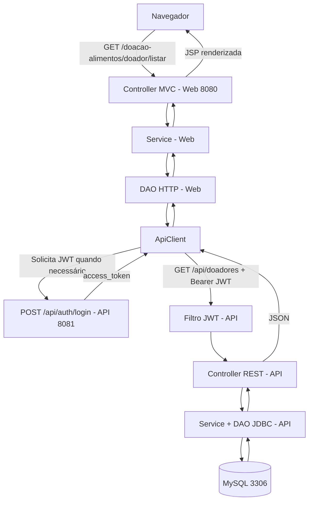

# DoaFácil — Arquitetura final Web + API REST

## Contexto

A Pessoa 1 desenvolveu a API independente (`doafacil-api`) com endpoints de Doadores, Instituições e Doações, MySQL e autenticação JWT. A Pessoa 2 adaptou o projeto MVC/JSP original (`doacao-alimentos`) para consumir essa API por HTTP com JSON e JWT e retirou o acesso direto ao banco do Web.

## Fluxo de consulta

## Responsabilidades

| Componente | Responsabilidade | Não deve fazer |
|---|---|---|
| Web 8080 | Renderizar JSP, receber formulários, executar MVC/Services e consumir API via HTTP | Abrir conexões SQL ou expor REST duplicado |
| `ApiClient` | HTTP GET/POST/PUT/DELETE, JSON e cabeçalho Bearer | Guardar credenciais diretamente no código |
| `ApiAuthService` | Obter JWT, reutilizar o token em memória e renovar quando aplicável | Expor o segredo de assinatura JWT ao navegador |
| API 8081 | Validar JWT, expor endpoints REST, aplicar regras e executar DAO JDBC | Servir as páginas JSP do Web |
| MySQL | Persistência das três entidades | Ser acessado pelo processo Web |

## Rotas

| Web MVC (8080) | API REST (8081) |
|---|---|
| `/doador/listar`, `/doador/inserir`, `/doador/alterar`, `/doador/deletar` | `/api/doadores` e `/api/doadores/{id}` |
| `/instituicao/listar`, `/instituicao/inserir`, `/instituicao/alterar`, `/instituicao/deletar` | `/api/instituicoes` e `/api/instituicoes/{id}` |
| `/doacao/listar`, `/doacao/inserir`, `/doacao/alterar`, `/doacao/deletar` | `/api/doacoes` e `/api/doacoes/{id}` |

O endpoint `GET /api/status` é público na API; os CRUDs exigem `Authorization: Bearer <JWT>`.

## Configuração de ambiente

API (8081): `DB_URL`, `DB_USER`, `DB_PASSWORD`, `API_AUTH_USER`, `API_AUTH_PASSWORD`, `JWT_SECRET_BASE64`, `JWT_TTL_MINUTES`.

Web (8080): `DOAFACIL_API_URL` (opcional), `DOAFACIL_API_USER`, `DOAFACIL_API_PASSWORD`.

As credenciais de login no Web correspondem à conta de integração da API, **não** à conta de conexão do MySQL. Segredos ficam fora do Git. O projeto não implementa autenticação individual de usuários por meio desse JWT.

## Verificações da separação

1. `GET http://localhost:8081/doafacil-api/api/status` retorna 200.
2. `GET http://localhost:8080/doacao-alimentos/api/status` retorna 404, pois o Web não deve oferecer REST próprio.
3. O WAR do Web não contém `mysql-connector-j`, `HikariCP` nem antigos Controllers REST.
4. Com a API desligada, uma listagem do Web que depende dela não deve continuar consultando diretamente o MySQL. Faça esse teste **somente em modo leitura**, religando a API em seguida.
5. Formulários e três listagens JSP continuam funcionando com a API ligada.

## Escopo e limitações

A comunicação é local (`localhost`) para a demonstração acadêmica. Os testes existentes focam o funcionamento dos CRUDs e a segurança básica de JWT; não representam certificação de segurança ou prontidão para produção. A apresentação deve diferenciar a autenticação entre serviços de um sistema de contas individuais.
